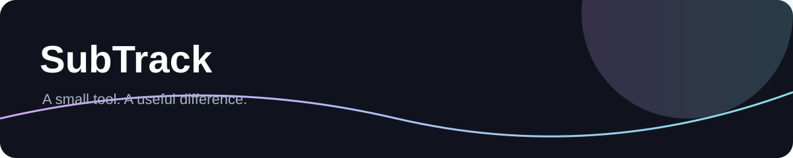

# SubTrack

A zero-dependency subtitle workshop for editing SRT and WebVTT files directly in your browser.

## Features
- Open SRT and VTT text files
- Edit subtitle text in a plain workspace
- Shift all cue timestamps forward or backward
- Detect malformed timestamps and overlapping cues
- Preview parsed cues and export SRT or WebVTT
- No upload, account, build step, or external library

## Run it
1. Download **Code → Download ZIP** and extract the folder.
2. Open `index.html` in a modern browser.
3. Open a subtitle file or paste subtitle text, edit, then export.

Optional: run `python -m http.server 8000` and open `http://localhost:8000`.

## Notes
SubTrack focuses on standard timestamped SRT/WebVTT cues. Review exported subtitles in your target media player, especially after large timing shifts. Original files are never overwritten.

## License
MIT — see [LICENSE](LICENSE).
